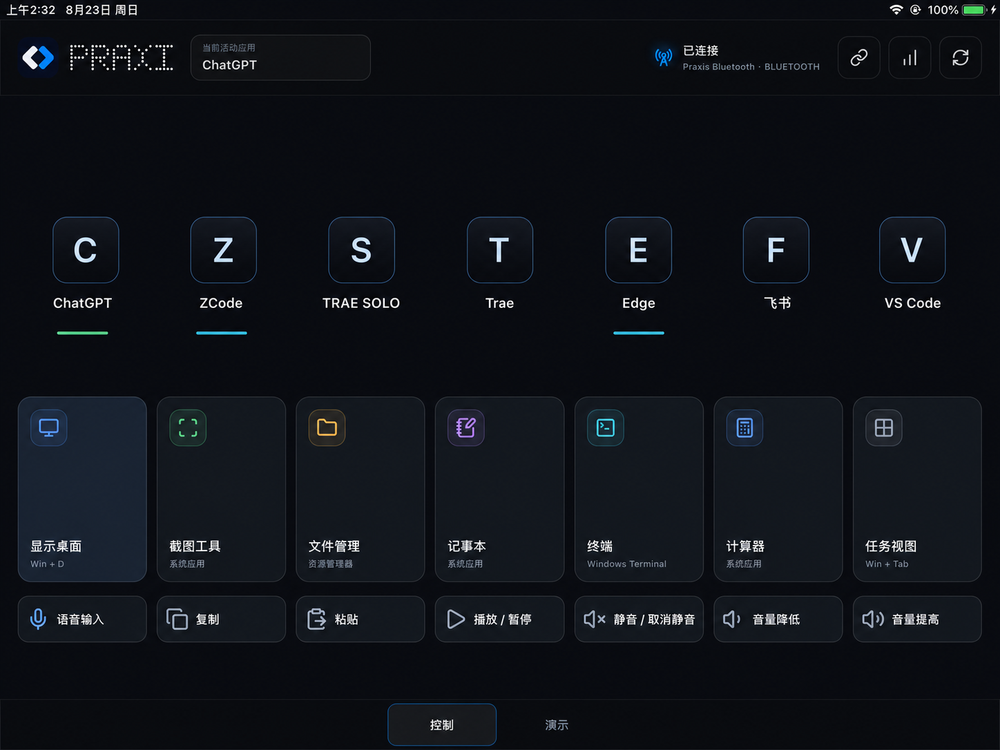
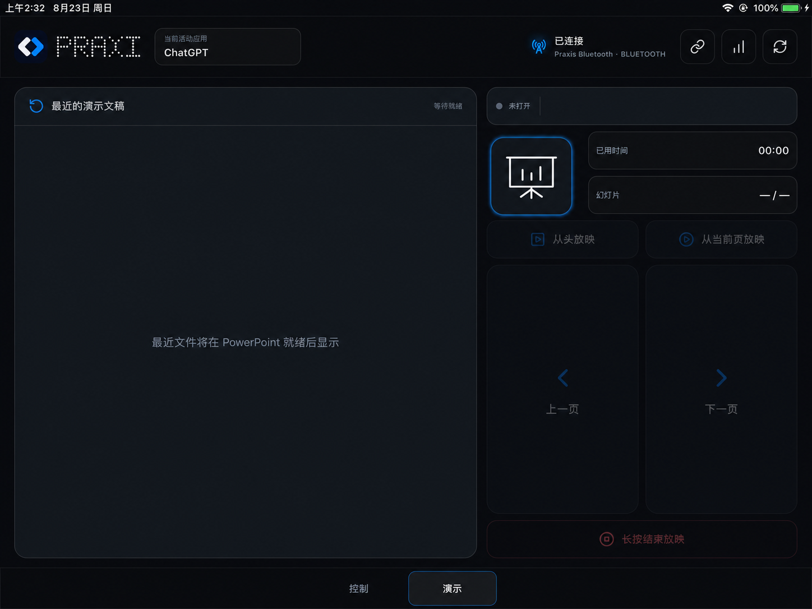

# Praxis Bluetooth 1.2.0

[中文说明](#中文说明) · [English](#english)

## 界面预览 / Interface preview

### 控制 / Control



### 演示 / Presentation



为避免在开源仓库中重新分发第三方商标，预览图中的八个应用入口使用中性
占位图标。实际连接后，Praxis 会从用户电脑上已安装的应用中提取图标并传给
iPad。应用名称仅用于如实说明兼容性，不表示相关厂商对 Praxis 的授权、赞助
或背书。

To avoid redistributing third-party trademarks, the eight application entries
in these previews use neutral placeholder marks. After pairing, Praxis extracts
icons from applications installed on the user's own PC and transfers them to
the iPad. Product names identify compatibility only and do not imply
authorization, sponsorship or endorsement.

## 中文说明

Praxis Bluetooth 把 iPad 变成 Windows PC 的原生控制与演示面板。Windows
端负责执行应用切换、系统指令、快捷键和 PowerPoint 自动化，iPad 端负责触控
界面；两端仅通过 Bluetooth Low Energy 直连，不需要局域网或云服务。

### 主要功能

- 像任务栏按钮一样启动、显示或最小化七个预设 Windows 应用。
- 打开常用系统工具，发送媒体、剪贴板、语音输入及键盘快捷指令。
- 浏览最近的 PowerPoint 文件，控制放映、翻页和结束放映，并显示页码、已用
  时间及演讲者备注。
- 将应用及系统状态反馈到 iPad，通过六位配对码建立信任并在以后自动重连。

### 运行条件

| 组件 | 最低基线 |
| --- | --- |
| Windows | Windows 10/11、支持 Bluetooth LE 的适配器、x64 |
| Windows 源码构建 | .NET 10 SDK、Windows 10 SDK 10.0.22621 或更高版本 |
| iPad | iPad mini 2、iOS 12.5.8 或更高版本、横屏使用 |
| iPad 源码构建 | 能够构建 iOS 12 目标的 Mac 和 Xcode |
| 演示功能 | 安装支持 COM 自动化的桌面版 Microsoft PowerPoint |

### 公开版本与开发方式

本公开仓库只发布 Praxis Bluetooth 的稳定版本：`main` 保存最新的公开快照，
`bluetooth-v1.2.0` 等标签对应已经固定并验证的发行版。项目的日常开发和未完成
工作在私有开发仓库进行；版本完成验证后，再以不包含私有历史的干净提交同步到
这里。公开仓库不包含 Network 版本。

问题反馈和范围明确的 Pull Request 仍然欢迎；采纳的修改会进入后续公开版本。

### 当前八个应用预设

Praxis 当前为八个应用提供兼容预设。控制页包含七个任务栏式应用按钮，演示页
另外包含 PowerPoint：

| 页面 | 应用 | 默认处理方式 |
| --- | --- | --- |
| 控制 | ChatGPT | 根据 Windows 应用注册信息和正在运行的进程识别 |
| 控制 | ZCode | 默认检查 `C:\Program Files\ZCode\ZCode.exe` |
| 控制 | TRAE SOLO | 默认检查当前用户的 `Programs\TRAE SOLO` 安装目录 |
| 控制 | Trae | 默认检查当前用户的 `Programs\Trae` 安装目录 |
| 控制 | Microsoft Edge | 默认检查系统的 Edge 安装目录 |
| 控制 | 飞书 | 默认检查当前用户的飞书安装目录 |
| 控制 | Visual Studio Code | 默认检查当前用户的 VS Code 安装目录 |
| 演示 | Microsoft PowerPoint | 通过桌面版 PowerPoint COM 自动化控制，默认检查 Office 16 安装目录 |

这些是兼容配置，不代表仓库包含、安装或授权上述软件。七个控制页应用使用与
Windows 任务栏按钮相近的切换逻辑：未运行时启动，运行时在显示和最小化之间
切换。PowerPoint 使用独立的演示控制逻辑，可打开或显示软件、选择最近文件、
放映、翻页、结束放映并读取页码和演讲者备注。

不同版本或自定义安装位置可能与默认路径不一致。此时请编辑**实际运行目录**中
的 `data/praxis.json`，修改相应动作的 `file`、`iconFile`、`processNames` 或
应用注册信息，然后重启 Praxis Bluetooth。安装版的默认配置位置是：

```text
%LOCALAPPDATA%\Programs\Praxis Bluetooth\data\praxis.json
```

便携版使用解压目录下的 `data\praxis.json`。从源码开发时，可修改
`src/Praxis.Core.Bluetooth/data/praxis.json` 后重新构建。

第三方应用图标不会随源码或安装包分发。Praxis 只会从用户自己安装的应用中
提取图标，通过已认证的蓝牙连接传给 iPad，并在该 iPad 上缓存。应用不存在或
路径无法识别时，可能显示字母占位图，相关按钮也无法启动该应用。README 中
的界面预览同样使用中性占位图，不包含八个预设应用的官方图标。

### 语音输入按钮必须核对

“语音输入”按钮当前只是一个快捷键预设，默认发送：

```text
RightAlt+Space
```

这个组合键不是所有电脑或语音软件的通用标准。用户应根据自己的 Windows
版本、输入法或语音软件修改 `shortcut.voiceInput` 动作。例如，需要调用
Windows 自带语音输入时，通常可改为：

```json
{
  "id": "shortcut.voiceInput",
  "parameters": {
    "keys": "Win+H"
  }
}
```

可用按键名称包括 `Ctrl`、`Shift`、`Alt`、`RightAlt`、`Win`、字母、数字、
`F1`–`F24`、`Enter`、`Escape`、`Space`、`Tab`、方向键以及常用导航键；使用
加号组合，例如 `Ctrl+Shift+B`。修改后必须重启 Windows 端服务。无效按键会
被明确拒绝，不会被静默替换成其他操作。

### 快速开始

1. 在 Windows 上安装并启动 Praxis Bluetooth。
2. 在 Mac 上用 Xcode 和自己的 Apple Team 签名并安装 iPad App。
3. 在 Windows 通知区查看六位配对码，并在 iPad 上输入。
4. 等待初始化完成；首次连接可能需要提取并传输应用图标，后续连接会使用缓存。
5. 先核对八个应用的安装位置和语音输入快捷键，再开始日常使用。

完整安装说明见 [`INSTALLATION.md`](INSTALLATION.md)，iPad 构建和真机说明见
[`src/Praxis.Panel.iOS/README.md`](src/Praxis.Panel.iOS/README.md)。

## English

Praxis Bluetooth turns an iPad into a native control and presentation panel
for a Windows PC. The Windows app executes controls and observes PowerPoint;
the iPad app provides the touch interface. Both devices communicate directly
over Bluetooth Low Energy without a LAN or cloud service.

Praxis is independent, open-source software. It is not an official client of
OpenAI, Microsoft, Apple, ByteDance, Lark, TRAE, ZCode or any other application
shown in the panel.

## What it does

- Toggle seven configured Windows applications like taskbar buttons, with
  PowerPoint as the eighth application preset on the presentation page.
- Open Windows tools and send media, clipboard and keyboard shortcuts.
- Open recent PowerPoint files, start and end a slide show, navigate slides,
  view page progress, elapsed time and speaker notes.
- Report local application and system state to the iPad.
- Pair once with a six-digit code, then reconnect automatically.

## Product structure

```text
Windows PC                                      iPad
Praxis Bluetooth                                Praxis Panel
actions, state, PowerPoint, BLE Central    <──>  UIKit, BLE Peripheral
                         Praxis Link
```

- `src/Praxis.Core.Bluetooth/`: complete Windows application.
- `src/Praxis.Link.Bluetooth/`: internal BLE transport and Praxis Link framing.
- `src/Praxis.Panel.iOS/`: complete native iPad application and Xcode project.
- `tests/`: Windows core, presentation, scheduling and security self-tests.
- `tools/Praxis.BluetoothCentralProbe/`: BLE compatibility diagnostic tool.

The `main` branch contains Bluetooth only. It does not start an HTTP or
WebSocket server and does not include a browser panel or LAN fallback.

This public repository contains stable Praxis Bluetooth snapshots. Day-to-day
development and unfinished work remain in a private development repository;
validated versions are synchronized here without transferring private history.
Issues and focused pull requests are welcome, and accepted changes are carried
into subsequent public releases.

## Compatibility

| Component | Supported baseline |
| --- | --- |
| Windows | Windows 10/11, Bluetooth LE adapter, x64 release |
| Windows development | .NET 10 SDK, Windows 10 SDK 10.0.22621 or newer |
| iPad | iPad mini 2 baseline, iOS 12.5.8 or newer, landscape |
| iPad development | A Mac and Xcode capable of building the iOS 12 target |
| Presentation | Desktop Microsoft PowerPoint with COM automation |

Bluetooth hardware and drivers vary. See `docs/bluetooth-central-validation.md`
when the PC can use a Bluetooth mouse but Praxis cannot discover the panel.

## Build and run on Windows

For installation without development tools, download the Windows installer
from GitHub Releases. See [`INSTALLATION.md`](INSTALLATION.md).

```powershell
.\scripts\run.ps1
.\scripts\test.ps1
.\scripts\publish.ps1
```

The self-contained release is written to:

```text
artifacts/publish/bluetooth-win-x64/
```

Run `Praxis.Bluetooth.exe`. It has no foreground console window and uses a
Praxis icon in the Windows notification area. The tray menu shows connection
state, the temporary pairing code, pairing controls and Exit.

Application locations are resolved from the default configuration, running
processes and installed-package metadata. Edit the copied `data/praxis.json`
only when an application uses a nonstandard installation location.

The voice-input control is a user-configurable hotkey preset. Its default is
`RightAlt+Space`; verify it against the voice-input software installed on the
PC and change `shortcut.voiceInput.parameters.keys` when necessary. `Win+H`
is a common Windows voice-typing alternative.

## Build the iPad app

The iPad app must be signed for the developer's Apple account and device. The
shortest Xcode installation path is documented in
[`INSTALLATION.md`](INSTALLATION.md); an unsigned IPA is intentionally not
published because iPadOS cannot install it.

```bash
xcodebuild \
  -project src/Praxis.Panel.iOS/PraxisPanelIOS.xcodeproj \
  -scheme PraxisPanelIOS \
  -destination 'generic/platform=iOS' \
  -derivedDataPath /tmp/PraxisPanelDerivedData \
  CODE_SIGNING_ALLOWED=NO \
  build
```

Signing, device installation and detailed testing instructions are in
[`src/Praxis.Panel.iOS/README.md`](src/Praxis.Panel.iOS/README.md).

## First connection

1. Start Praxis Bluetooth on Windows.
2. Open Praxis Panel on the iPad and allow Bluetooth access.
3. Open the Windows notification-area menu and read the six-digit pairing code.
4. Enter it on the iPad. The code positions show dashes until digits are typed.
5. Praxis stores the trusted-device record locally and reconnects automatically
   on later launches.

The code is rate limited and temporary. Authenticated messages carry a session
identifier, monotonic sequence and HMAC so altered or replayed controls are
rejected. BLE UUIDs and the 12-byte frame format remain public and unchanged.
See [`SECURITY.md`](SECURITY.md) for the security model and reporting process.

## Application icons

Third-party application logos are not stored in this repository or licensed as
MIT assets. Praxis extracts the icon from each application installed on the
user's own PC, transfers it through the authenticated Bluetooth session and
caches it on that user's iPad. A neutral letter mark is shown until an icon is
available. The README previews also use neutral placeholders rather than the
official logos of the eight preset applications. System, shortcut and
presentation glyphs are bundled Lucide vector assets under the license recorded
in
[`THIRD_PARTY_NOTICES.md`](THIRD_PARTY_NOTICES.md).

## Protocol boundary

- Service: `7a51f000-5e8f-4c7a-9a1d-707261786973`
- Command to Core: `7a51f001-5e8f-4c7a-9a1d-707261786973`, iPad → PC, Notify
- Event from Core: `7a51f002-5e8f-4c7a-9a1d-707261786973`, PC → iPad, Write
- Peer Info: `7a51f003-5e8f-4c7a-9a1d-707261786973`, Read
- Praxis Link: 12-byte little-endian header, protocol version 1, maximum
  unframed message size 65,536 bytes

Pairing and authenticated messages are ordinary Praxis protocol payloads above
this framing layer; the BLE UUIDs, roles and frame representation did not change.

## Privacy

Praxis contains no analytics, advertising, telemetry or cloud upload. System
state, file paths, slide titles and speaker notes remain between the paired PC
and iPad. See [`PRIVACY.md`](PRIVACY.md).

## Contributing

Please read [`CONTRIBUTING.md`](CONTRIBUTING.md) and [`SECURITY.md`](SECURITY.md)
before opening a pull request. Do not contribute extracted product logos,
Apple-exported symbols, device records, signing files or local configuration.

## License

Praxis-owned source code and original artwork are available under the
[MIT License](LICENSE). Third-party platform components, product names and
trademarks remain subject to their owners' terms; see
[`THIRD_PARTY_NOTICES.md`](THIRD_PARTY_NOTICES.md).
